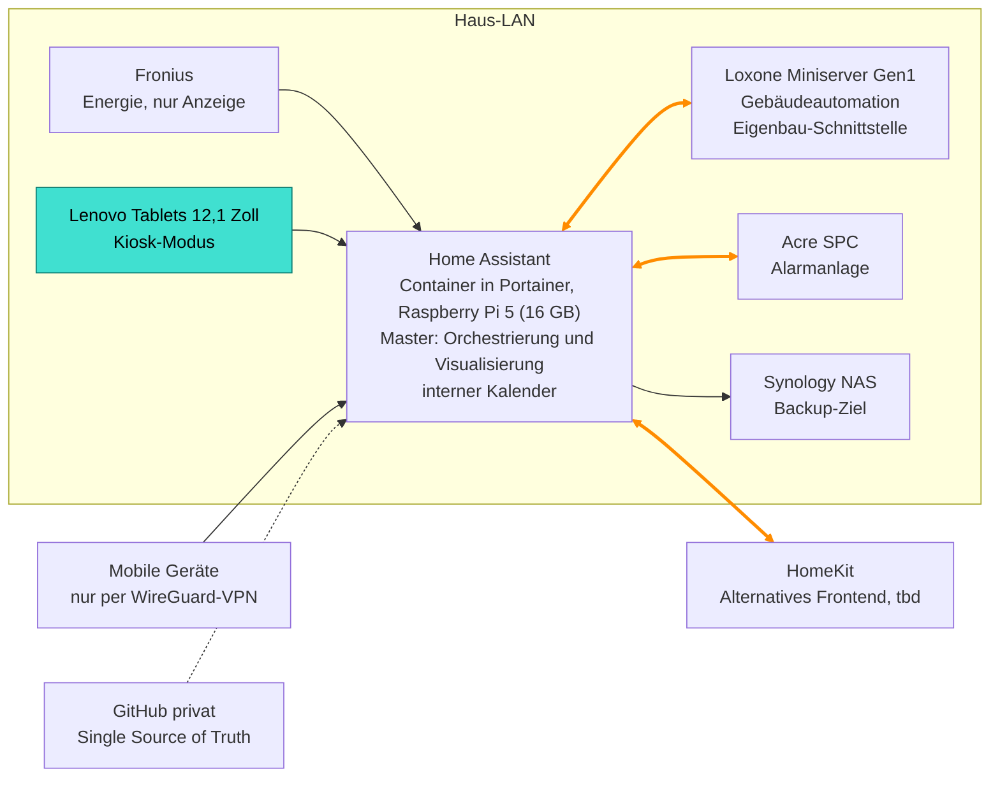

# 02 Kontextdiagramm

Stand: 2026-11-25 · Status: Freigegeben (2026-11-25) · Paket 1 und 1b

Legende: Orange Linien sind bidirektionale Schnittstellen, türkise Knoten sind die Tablets.

## Vertrauenszonen und Grundsätze

- Loxone und SPC bleiben führend für ihre Funktionen. HA ist Leitstand, nicht Ersatz.
- HA ist die einzige Instanz, die Frontends bedient. Tablets, Mobilgeräte und HomeKit greifen nie direkt auf SPC oder Loxone zu.
- Kein Zugang aus dem Internet, nur WireGuard.
- Die Schnittstellen im Detail stehen in `05-interfaces.md` (Paket 3, Entwurf).
