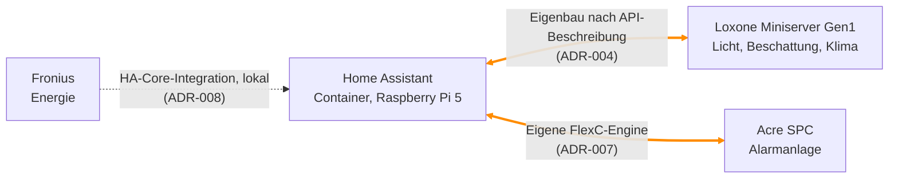

# 05 Schnittstellen

Stand: 2026-11-27 · Status: Entwurf (zur Freigabe) · Paket 3

Dieses Dokument beschreibt, wie Home Assistant (HA) mit Loxone Gen1, Acre SPC und Fronius verbunden wird. Es enthält keinen Implementierungscode. Aussagen zu Versionen und Schnittstellen sind geprüft (mit Quelle) oder als „zu prüfen“ markiert.

Legende im Diagramm: Orange = bidirektionale Schnittstelle, gestrichelt = nur Anzeige (lesend).

## 1. Gemeinsame Regeln für alle Schnittstellen

| Regel | Begründung |
|---|---|
| HA nutzt je System ein eigenes Konto mit minimalen Rechten (NFR-02) | Least Privilege, Missbrauch eines Kontos bleibt begrenzt |
| Zugangsdaten liegen nie im Repository, nur der Ablageort wird genannt (NFR-04) | Secret-Schutz, Ablage legt Paket 4 fest |
| Loxone und SPC arbeiten bei Ausfall von HA oder der Schnittstelle unverändert weiter (NFR-01) | Stabilität vor Features |
| Unverschlüsselte Verbindungen nur im getrennten Haus-LAN und nie über Zonengrenzen hinweg | Schutz vor Mitlesen, Zonen folgen in Paket 4 |
| Jede Schaltaktion ist nachvollziehbar (wer, wann, was), sofern das System es hergibt | Audit, Schutzstufe S1 |
| Bei Verbindungsverlust zeigt HA „nicht verfügbar“ und schaltet nichts auf Verdacht | Kein Fehlverhalten durch veraltete Zustände |
| Schalten über Schnittstellen folgt dem Rechtemodell aus `04-rbac.md` (Schutzstufen S1 bis S3) | Die Schnittstelle erzwingt die Rechte nicht allein, HA ist Teil der Kette |

## 2. Loxone Gen1 (Eigenbau, ADR-004)

### Zweck und Richtung

Bidirektional. HA liest Zustände (Licht, Beschattung, Klima) und sendet Schaltbefehle. Loxone bleibt führend für die Gebäudelogik (Kontextdiagramm, Grundsätze).

### Was bekannt ist (geprüft, Stand 2026-11-26)

- Loxone beschreibt Web Services über HTTP, mit denen sich Werte abfragen und Ausgänge schalten lassen. Die Firmware-Version liefert der Aufruf `/dev/cfg/version` am Miniserver.
- Zusätzlich gibt es eine WebSocket-Kommunikation nach RFC 6455. Die öffentliche Beschreibung („Communicating with the Miniserver“, V17.0, 31.3.2026) hat einen eigenen Abschnitt für Miniserver Generation 1.
- Der Miniserver Gen1 erhält Updates „bis auf Weiteres“, mit möglichen Abweichungen im Funktionsumfang (R-02).
- Loxone leistet keinen regulären Support für eigene API-Integrationen, Schnittstellen können durch Updates angepasst werden (Angabe des Auftraggebers aus der Loxone-Beschreibung).

Quellen: <https://www.loxone.com/enen/kb/web-services/>, <https://www.loxone.com/dede/wp-content/uploads/sites/2/2026/04/1700_Communicating-with-the-Miniserver-2.pdf>, <https://www.loxone.com/enen/the-next-generation-miniserver/>

### Zu prüfen (Eingang durch den Auftraggeber)

- Firmware-Version: **17.3.11.10** (Angabe des Auftraggebers aus der Loxone-App, 2026-11-27). Sie passt zur Hauptversion 17 der öffentlichen Beschreibung (V17.0). Ob alle dort beschriebenen Funktionen auf Gen1 verfügbar sind, wird beim Abgleich geprüft (OP-11).
- Abgleich der privaten API-Beschreibung des Auftraggebers mit der öffentlichen Beschreibung (OP-11). Die private Beschreibung kommt nicht in das Repository, wenn sie Zugangsdaten oder interne Angaben enthält. Ablageort wird in Paket 4 festgelegt.
- Verschlüsselung: Die Loxone-App zeigt für die interne Verbindung „nicht verschlüsselt“ (Stand 2026-11-27). Ob Gen1 eine verschlüsselte Verbindung anbietet, ist zu prüfen (OP-11). Bis dahin gilt: nur im Haus-LAN, dediziertes Konto, Zonentrennung in Paket 4.

### Datenmodell (fachlich, ohne Codierung)

| Kategorie | Lesen (Zustand) | Schreiben (Befehl) | Schutzstufe |
|---|---|---|---|
| Licht | an/aus, Dimmstufe | an/aus, dimmen | S2 |
| Beschattung | Position, Lamellenstellung | auf/zu/Position | S2 |
| Klima | Ist-Temperatur, Soll-Temperatur, Betriebsart | Soll-Temperatur, Betriebsart | S2 |

- Jedes Objekt wird in Loxone eindeutig identifiziert und in HA je Raum und Kategorie abgebildet. Die Raum- und Kategoriezuordnung ist Grundlage für die Kinder-Rechte (FR-06).
- Nur die Objekte, die in `04-rbac.md` vorkommen, werden freigegeben. Alles andere bleibt unsichtbar (Least Privilege).
- Die Zuordnung Objekt, Raum, Kategorie wird als Tabelle im Betrieb gepflegt (`operator-guide.md`).

### Rechte und Konten

- Ein eigenes Loxone-Benutzerkonto für HA, mit Rechten nur auf die freigegebenen Objekte.
- Kein Admin-Konto von Loxone in HA.

### Fehlerverhalten

| Fall | Verhalten |
|---|---|
| Miniserver nicht erreichbar | Entitäten „nicht verfügbar“, keine Befehle, Wiederverbindung mit steigenden Abständen |
| Befehl wird nicht bestätigt | Rückmeldung „fehlgeschlagen“, kein stilles Wiederholen von Schaltbefehlen |
| Verbindung bricht ab | Zustände nach Wiederverbindung neu lesen, bevor Automationen wieder wirken |
| Schnittstelle abgeschaltet | Loxone läuft unverändert weiter (NFR-01, ADR-004 Rollback) |

### Sicherheit

- Befehle nur im Haus-LAN, kein Zugriff aus dem Internet (NFR-03).
- Rate-Begrenzung für Befehle, damit eine fehlerhafte Automation Loxone nicht überlastet (Gen1 hat begrenzte Leistung, zu prüfen).
- Anmeldedaten in der vereinbarten Secret-Ablage (Paket 4).

### Tests (für die Umsetzung vorgesehen)

- Zustand lesen und mit der Loxone-Oberfläche vergleichen, je Kategorie.
- Befehl senden, Rückmeldung und tatsächlichen Zustand prüfen.
- Miniserver vom Netz trennen und wieder verbinden, Verhalten laut Tabelle prüfen.
- Konto-Rechte: Zugriff auf nicht freigegebene Objekte muss scheitern.
- Ausfall von HA: Loxone bedienbar wie zuvor.

## 3. Acre SPC (eigene FlexC-Engine, ADR-007)

### Zweck und Richtung

Bidirektional: Status und Rückmeldung anzeigen, scharf/unscharf schalten (FR-03). Schutzstufe S1. Die PIN gehört pro Person (FR-15) und soll möglichst an der Quelle geprüft werden.

### Bekannte Wege (geprüft, Stand 2026-11-26)

| Weg | Beschreibung | Stand |
|---|---|---|
| A: HA-Core-Integration „Vanderbilt SPC“ | Läuft über ein Drittanbieter-Gateway („SPC Web Gateway“), das im Netz installiert sein muss. Entitäten: Alarm und Binärsensoren. | In HA vorhanden, Qualitätsstufe „legacy“ laut HA-Dokumentation |
| B: Community-Integration `spc_web` | Verbindet über die Weboberfläche des Panels ohne Gateway. Lockert bewusst die TLS-Sicherheit, weil das Panel eine sehr alte TLS-Version nutzt. Nur lokal oder per VPN. | Drittanbieter, nicht Teil von HA |
| C: Eigenbau über FlexC | FlexC ist das verschlüsselte Multipath-Protokoll von Vanderbilt, vorhanden ab Panel-Firmware 3.6. Die FlexC-Spezifikation liegt dem Auftraggeber vor. | Spezifikation noch nicht im Repo, Eingang nötig |

Quellen: <https://www.home-assistant.io/integrations/spc/>, <https://github.com/awahlig/spc_web>, <https://manuals.plus/lundix/spc-bridge-modbus-manual>

### Kernproblem: PIN an der Quelle

- Laut Community-Bericht schaltet die HA-Core-Integration ohne Code scharf. Das ist ein Forenbericht, kein offizieller Nachweis, und spielt für den gewählten Weg keine Rolle mehr, weil diese Integration nicht genutzt wird.
- Ob SPC über FlexC personenbezogene Codes mit eigenen Rechten und Protokollierung unterstützt und ob ein Fremdsystem damit scharf schalten darf, kann nur anhand der FlexC-Spezifikation und des Panels beantwortet werden (OP-13).

### Entscheidung (2026-11-27)

Option C: eine eigene FlexC-Engine liefert Status und nimmt Schaltbefehle an, HA zeigt an und bedient. Die Engine meldet sich mit einem gespeicherten SPC-Konto am Panel an (Ablage in der Secret-Ablage, nie im Repo). Die HA-Integration und `spc_web` werden nicht genutzt. Begründung und Folgen: ADR-007.

Folgen für die Schnittstelle:

- Das Panel sieht nur das Dienstkonto. Die PIN pro Person prüft die Engine, nicht die HA-Oberfläche. Die Zuordnung Person zu Aktion steht im Audit-Log der Engine (OP-13: prüfen, ob FlexC den Code je Befehl mitgeben lässt).
- Die Engine nimmt Befehle nur von HA an, mit Rollenprüfung und PIN, und läuft getrennt von HA (NFR-01).
- Das Dienstkonto hat nur Status- und Scharfschalt-Rechte, keine Programmierung (R-14).

### Fehlerverhalten (unabhängig vom Weg)

| Fall | Verhalten |
|---|---|
| SPC nicht erreichbar | Status „nicht verfügbar“, kein Schalten, Hinweis auf dem Tablet |
| Schalten abgelehnt (falsche PIN, Rechte) | Rückmeldung mit Grund, Eintrag im HA-Logbuch |
| Schalten angefordert, Zustand ändert sich nicht | Rückmeldung „nicht bestätigt“, kein stilles Wiederholen |
| Ausfall von HA | SPC arbeitet unverändert weiter (NFR-01) |

### Sicherheit

- SPC ist nie direkt aus dem Internet oder von Tablets erreichbar, nur HA (Kontext).
- Gateway oder Eigenbau liegt im getrennten Netzsegment (Paket 4).
- Zugang zum Panel mit dediziertem, eingeschränktem Dienstkonto (Annahme 3 in den Anforderungen), Zugangsdaten nur in der Secret-Ablage.
- Alarm-Schalten ist Schutzstufe S1 und bleibt für Kinder aus, bis Admin freigibt (OP-08).

### Tests (für die Umsetzung vorgesehen)

- Status je Bereich und Zone mit der SPC-Bedienung vergleichen.
- Scharf/unscharf mit gültiger und ungültiger PIN, Rückmeldung und SPC-Protokoll prüfen.
- Verhalten bei Netztrennung zwischen HA und Panel.
- Ein Kind-Konto darf nichts schalten und nichts sehen, solange nicht freigegeben.

## 4. Fronius (nur Anzeige, ADR-008)

### Zweck und Richtung

Nur lesend (FR-04). HA nutzt die vorhandene Fronius-Integration von HA Core. Sie arbeitet lokal über die JSON-Schnittstelle der Geräte, nicht über die Cloud.

### Anlage des Auftraggebers (aus der Solar.web-Geräteliste, ohne Anlagenname und Seriennummern)

| Gerät | Typ |
|---|---|
| Wechselrichter | Fronius Primo 4.6-1 |
| Wechselrichter (Hybrid) | Fronius Symo Hybrid 5.0-3-S |
| Batteriemanagement | BatteryManagementSystem |
| Zähler | PowerMeter |
| Datenlogger | 2 Stück |

Installiert 2017-06-30, Leistung 13,2 kWp.

### Was bekannt ist (geprüft, Stand 2026-11-26)

- Die HA-Integration unterstützt Primo, Symo, Symo Hybrid, Tauro und Verto sowie angeschlossene Geräte wie Zähler (Smart Meter oder S0), Ohmpilot und Storage.
- Für Gen24-Geräte mit Firmware ab 1.14.1 muss „Solar API“ am Wechselrichter aktiviert werden, bei älteren Geräten ist sie standardmäßig aktiv. Die Anlage des Auftraggebers ist von 2017 und damit nicht Gen24.
- Die Integration nutzt die lokale JSON-Schnittstelle, nicht die Cloud (Aussage des Maintainers der Integration im HA-Forum).
- Ein Forenbeitrag beschreibt, dass bei zwei Wechselrichtern an einem Zähler die Zähler- und Erzeugungsdaten nicht immer vollständig sind, wenn der Zähler nicht über SolarNet an beiden hängt. Das wird für die konkrete Anlage geprüft.

Quellen: <https://www.home-assistant.io/integrations/fronius/>, <https://community.home-assistant.io/t/fronius-modbus-integration/803051>, <https://community.home-assistant.io/t/fronius-solar-web-integration-in-ha/508940>

### Zu prüfen (OP-14)

- Ist die lokale Solar API an den zwei Dataloggern und den Wechselrichtern erreichbar?
- Welches Gerät liefert welche Daten (Erzeugung, Batterie, Netzbezug, Verbrauch)? Stimmen die Werte mit Solar.web überein?
- Welche Entitäten gehören in die Energieanzeige (FR-01) und in die Rechte (Energie: Admin, Eltern, Kinder, FR-04).

### Rechte und Sicherheit

- Lesender Zugriff im Haus-LAN. Fronius-Geräte werden nicht aus dem Internet erreichbar gemacht.
- Schutzstufe S3: Anzeige ohne Schalten.

### Erweiterbarkeit (FR-13)

- Ladestrom-Balancing (Hausbatterie, Auto-Batterie) sind später Schreibzugriffe und eigene Sicherheits- und Planungsschritte. Dafür wird ein eigener ADR und ein eigenes Paket angelegt. Jetzt wird nur Lesen eingerichtet, damit keine Schreibrechte auf Energiegeräten entstehen.

### Fehlerverhalten

| Fall | Verhalten |
|---|---|
| Gerät nicht erreichbar (z. B. nachts, Wechselrichter schläft) | Werte „nicht verfügbar“, kein Fehlalarm. Verhalten nachts ist zu beobachten |
| Unplausible Werte | Anzeige unverändert, Abgleich mit Solar.web im Test |

### Tests (für die Umsetzung vorgesehen)

- Werte in HA mit Solar.web und dem Display der Geräte vergleichen (Erzeugung, Batterie, Netz).
- Verhalten bei Nacht und bei Netztrennung.
- Energiewerte für Kinder sichtbar, für Gäste nicht.

## 5. Offene Punkte und Verweise

OP-11 bis OP-14 und R-12 bis R-14 in `01-requirements.md`. Entscheidungen: ADR-004, ADR-007, ADR-008. Änderung: `changes/CHG-007-paket-3-schnittstellen.md`.
